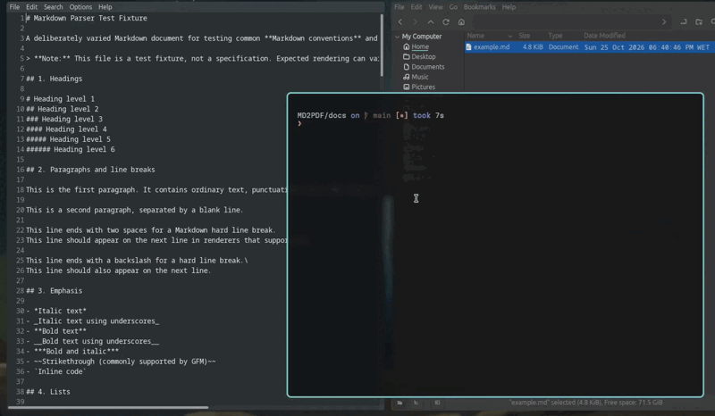
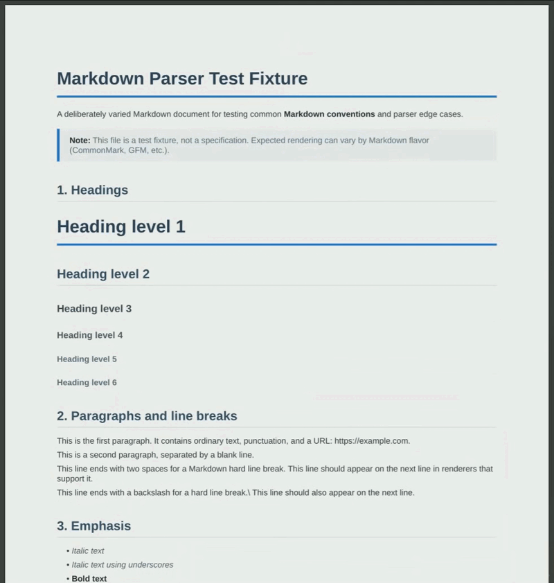
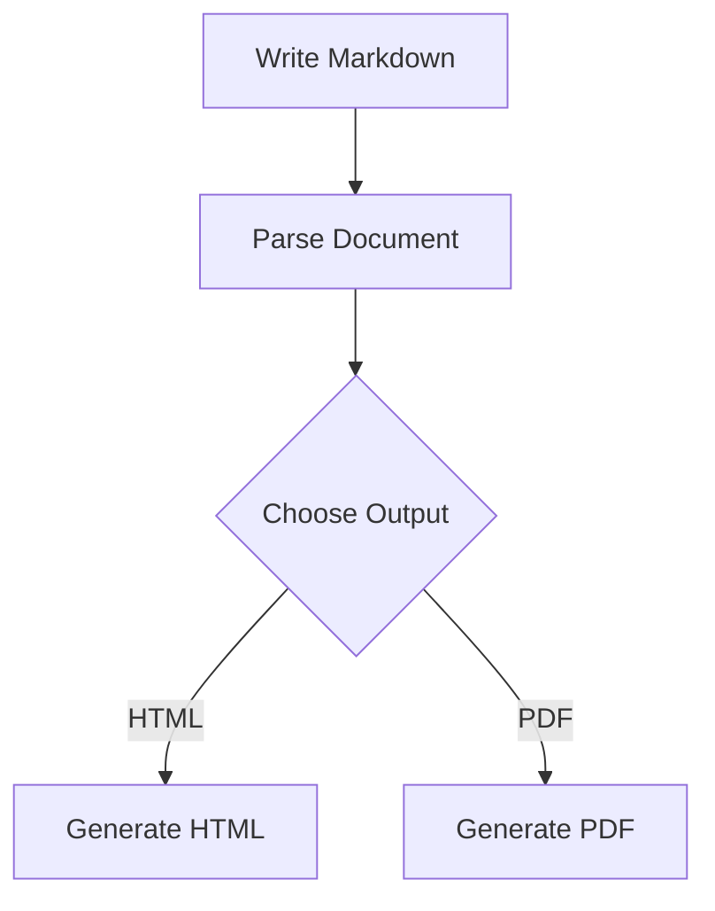

# MD2PDF

<p align="center">
  <strong>From Markdown to beautifully rendered documents.</strong>
  <br />
  A lightweight, Python-based Markdown converter for HTML and PDF.
  <br /><br />
  
  
    
  <a href="./LICENSE">
    
  </a>
</p>
<p align="center">
  <a href="https://github.com/Gonca7/MD2PDF/stargazers">
    
  </a>
  <a href="https://github.com/Gonca7/MD2PDF/actions/workflows/main.yml">
    
  </a>
</p>

---
## ✨ Overview

**MD2PDF** is an open-source Markdown converter built in Python, designed to turn Markdown documents into clean, styled HTML pages and PDF documents.

<div align="center" style="display: flex; justify-content: center; align-items: center; gap: 16px;">
  
  
</div>

Instead of relying entirely on an existing Markdown parsing library, MD2PDF uses its own parser and Abstract Syntax Tree (AST), giving it a foundation that can be extended and customized over time.

Whether you're writing technical documentation, project reports, notes, or README files, MD2PDF provides a simple interactive workflow for converting your content into a shareable document.

---

## 📚 Table of Contents

- [MD2PDF](#md2pdf)
  - [✨ Overview](#-overview)
  - [📚 Table of Contents](#-table-of-contents)
  - [🚀 Features](#-features)
  - [📦 Installation](#-installation)
    - [🐧 Linux](#-linux)
      - [Fedora](#fedora)
      - [Debian / Ubuntu](#debian--ubuntu)
      - [Install MD2PDF](#install-md2pdf)
    - [🪟 Windows \& 🍎 macOS](#-windows---macos)
  - [📝 Usage](#-usage)
    - [1. Select a Markdown file](#1-select-a-markdown-file)
    - [2. Choose a stylesheet](#2-choose-a-stylesheet)
    - [3. Select an output format](#3-select-an-output-format)
  - [📊 Mermaid diagrams](#-mermaid-diagrams)
  - [🎨 Custom CSS](#-custom-css)
  - [🛠️ Development](#️-development)
    - [Requirements](#requirements)
    - [Architecture](#architecture)
  - [🗺️ Roadmap](#️-roadmap)
  - [🤝 Contributing](#-contributing)
  - [License](#license)
  - [👨‍💻 Author](#-author)

---


## 🚀 Features

- **Markdown parsing** — A custom parser and AST-based processing pipeline.
- **HTML output** — Generate complete HTML documents from Markdown.
- **PDF generation** — Convert rendered HTML into PDF using WeasyPrint.
- **Mermaid diagrams** — Render Mermaid diagram code blocks into SVG.
- **Custom styling** — Use the default stylesheet or supply your own CSS.
- **Familiar Markdown syntax** — Support for headings, paragraphs, emphasis, links, images, lists, blockquotes, tables, and fenced code blocks.
- **HTML support** — Handle inline and block HTML through the rendering pipeline.
- **Interactive CLI** — Select input files, stylesheets, and output formats from the terminal.
- **Multiple output formats** — Generate HTML, PDF, or both in a single run.
- **Python package** — Install the application as a command-line tool.

## 📦 Installation

MD2PDF is a Python application that can be installed using `pipx`. This gives it an isolated Python environment and exposes the `md2pdf` command without requiring you to activate a virtual environment manually.

**Requirements**

- Python 3.10 or newer.
- Native system libraries required by WeasyPrint.

### 🐧 Linux

#### Fedora

Install the system dependencies and `pipx`:

```bash
sudo dnf install pipx
pipx ensurepath
```

Restart your terminal if necessary.

#### Debian / Ubuntu

```bash
sudo apt update
sudo apt install pipx
pipx ensurepath
```

#### Install MD2PDF

Clone the repository and install the package from its root directory:

```bash
git clone https://github.com/Gonca7/MD2PDF
cd MD2PDF

pipx install .
```

Launch the application:

```bash
md2pdf
```

The command should be available from any directory once the installation and PATH configuration are complete.

### 🪟 Windows & 🍎 macOS

Install Python 3.10 or newer and ensure Python is available on your PATH.

```
git clone https://github.com/Gonca7/MD2PDF
pip install -r requirements.txt
python ./main.py
```

## 📝 Usage

Start MD2PDF from your terminal:

```bash
md2pdf
```

The interactive CLI guides you through the conversion process.

### 1. Select a Markdown file

Enter the path to the `.md` file you want to convert.

Both absolute and home-relative paths are supported.

### 2. Choose a stylesheet

Select the default stylesheet or provide a path to your own `.css` file.

The default stylesheet is bundled with the package.

### 3. Select an output format

MD2PDF supports three output options:

| Option | Result |
|---|---|
| HTML | `document.html` |
| PDF | `document.pdf` |
| HTML + PDF | Both files |

The output files are created alongside the input Markdown file, using the same filename with a different extension.

For example:

```text
report.md
report.html
report.pdf
```

When both formats are selected, MD2PDF renders the Markdown into HTML once and uses that result for both outputs.

## 📊 Mermaid diagrams

MD2PDF supports Mermaid diagrams inside fenced Markdown code blocks.

For example:

````markdown

````

The Mermaid source is rendered into SVG and embedded in the generated HTML.

Diagram appearance can be configured through Mermaid's rendering options, while layout and spacing can be controlled using CSS.

## 🎨 Custom CSS

You can provide your own CSS stylesheet when prompted by the CLI.

For example:

```css
body {
    font-family: sans-serif;
    line-height: 1.6;
    color: #27272a;
}

h1,
h2,
h3 {
    color: #7c3aed;
}

pre {
    overflow-wrap: anywhere;
}

.mermaid-diagram {
    margin: 1rem auto;
    text-align: center;
    break-inside: avoid;
}

.mermaid-diagram img {
    max-width: 100%;
    max-height: 120mm;
    width: auto;
    height: auto;
}
```

The stylesheet is used by the HTML renderer, and the resulting HTML styling is carried into PDF generation through WeasyPrint.

Because browsers and PDF renderers can implement CSS features differently, some styles may need adjustments for PDF output.

## 🛠️ Development

Want to contribute or modify the parser?

### Requirements

- Python 3.10 or newer.
- Git.
- The dependencies declared in `pyproject.toml`.
- Native dependencies required by WeasyPrint.

### Architecture

The conversion process is split into several stages:

1. **Block parsing** — Recognizes block-level Markdown structures.
2. **Inline parsing** — Tokenizes and processes inline elements.
3. **AST construction** — Represents the parsed document using Python objects.
4. **Orchestration** — Coordinates parsing and document processing.
5. **HTML rendering** — Converts AST nodes into styled HTML.
6. **Mermaid rendering** — Converts Mermaid source into SVG.
7. **PDF rendering** — Uses WeasyPrint to generate the final PDF.

The separation between parsing and rendering makes it easier to extend the supported syntax and add new output capabilities.

## 🗺️ Roadmap

Potential future improvements include:

- [ ] Expand Markdown syntax coverage.
- [ ] Improve error reporting for malformed Markdown.
- [ ] Add more Mermaid rendering configuration options.
- [ ] Improve PDF pagination and layout controls.
- [ ] Add command-line arguments for non-interactive use.
- [ ] Provide downloadable standalone builds.
- [ ] Add automated cross-platform testing.
- [ ] Publish releases and a package on PyPI.

## 🤝 Contributing

Contributions, bug reports, and feature suggestions are welcome!

1. Fork the repository.
2. Create a feature branch.
3. Implement your change and add tests.
4. Run the test suite.
5. Open a pull request describing your changes.

For significant changes, consider opening an issue first to discuss the proposed approach.

## License

MD2PDF is licensed under the GNU General Public License v3.0 or later
(GPL-3.0-or-later).

See the [LICENSE](./LICENSE) file for the full license text.

## 👨‍💻 Author

Created by **Gonca7**.

---

<p align="center">
  <em>Write in Markdown. Render with style.</em>
</p>
